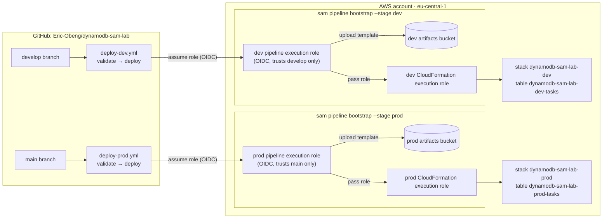

# dynamodb-sam-lab

An Amazon DynamoDB table defined with AWS SAM and deployed to two environments (dev and prod)
by SAM Pipelines and GitHub Actions, in `eu-central-1`.

## Architecture



## Table design

`dynamodb-sam-lab-<env>-tasks` uses **On-Demand** billing (`PAY_PER_REQUEST`) and the
**Standard-Infrequent Access** table class (`STANDARD_INFREQUENT_ACCESS`), not the default
`STANDARD`.

| Attribute   | Type | Role                                      |
|-------------|------|-------------------------------------------|
| `taskId`    | S    | Primary key (partition key)               |
| `status`    | S    | `StatusIndex` partition key               |
| `dueDate`   | S    | `StatusIndex` sort key                    |
| `assignee`  | S    | `AssigneeIndex` partition key             |
| `createdAt` | S    | `AssigneeIndex` sort key                  |
| `title`     | S    | Non-key attribute                         |
| `priority`  | S    | Non-key attribute                         |

| GSI             | Keys                    | Access pattern                          |
|-----------------|-------------------------|-----------------------------------------|
| `StatusIndex`   | `status` / `dueDate`    | Tasks in a given status, by due date    |
| `AssigneeIndex` | `assignee` / `createdAt`| Tasks for a given person, by creation   |

Both GSIs use `ProjectionType: ALL`, so a query on an index returns the whole item in the
console without a second lookup.

### Per-environment settings

| Setting | dev | prod |
| --- | --- | --- |
| `DeletionPolicy` / `UpdateReplacePolicy` | `Delete` | `Retain` |
| Deletion protection | off | on |
| Point-in-time recovery | off | on |
| Encryption at rest | on (AWS owned key) | on (AWS owned key) |

## Design decisions

| Decision | Why |
| --- | --- |
| `AWS::DynamoDB::Table` instead of `AWS::Serverless::SimpleTable` | `SimpleTable` can't define GSIs, a sort key, or `TableClass`. A plain CloudFormation resource is still valid in a SAM template. |
| `AWS::LanguageExtensions` transform | Lets `DeletionPolicy` / `UpdateReplacePolicy` use `Fn::If`, so one template serves both environments. It has to be listed before the SAM transform. |
| `CAPABILITY_AUTO_EXPAND`, not `CAPABILITY_IAM` | The template creates no IAM resources. `AUTO_EXPAND` is the only capability the transforms need. |
| One self-contained `samconfig.toml` block per environment | With `--config-env`, SAM CLI ignores `[default.*]` sections. Keeping `stack_name` in `global.parameters` means every command (`deploy`, `list stack-outputs`, `delete`) reads it from one place. |
| Bucket and role ARNs come from GitHub repo variables, not `samconfig.toml` | Each environment deploys through its own bootstrap outputs, and no account-specific values are committed. |
| GitHub OIDC instead of access keys | No long-lived AWS credentials are stored in GitHub. Each stage's role trusts only its own branch. |
| `validate` job before `deploy` | A template that fails lint never reaches the step that gets AWS credentials. Only the deploy job has `id-token: write`. |
| No `environment:` key on the deploy job | Setting one changes the OIDC subject claim to `…:environment:<name>`, which wouldn't match the branch-scoped trust policy that `sam pipeline bootstrap` creates. |
| `concurrency` with `cancel-in-progress: false` | Deployments queue rather than cancel, so a CloudFormation update is never interrupted mid-flight. |

## Repo layout

```text
template.yaml                      # SAM template: the Tasks table
samconfig.toml                     # Per-environment config ([dev.*] / [prod.*])
scripts/bootstrap-pipeline.sh      # One-time: sam pipeline bootstrap for dev + prod
.github/workflows/
  deploy-dev.yml                   # push to develop -> deploys the dev stack only
  deploy-prod.yml                  # push to main    -> deploys the prod stack only
docs/sample-items.json             # Sample items for console CRUD testing
```

## Pipeline design

| Environment | Branch    | Workflow          | Stack                   | Artifacts bucket            |
|-------------|-----------|-------------------|-------------------------|-----------------------------|
| dev         | `develop` | `deploy-dev.yml`  | `dynamodb-sam-lab-dev`  | bucket from `--stage dev`   |
| prod        | `main`    | `deploy-prod.yml` | `dynamodb-sam-lab-prod` | bucket from `--stage prod`  |

- `sam pipeline bootstrap` runs once per stage. Each stage gets its own artifacts bucket,
  pipeline execution role, and CloudFormation execution role.
- This repo doesn't use `sam pipeline init`'s single multi-stage workflow. It has two
  hand-written workflows, one per environment, and each one deploys only its own stack with
  only its own stage's variables.
- Workflows trigger only when `template.yaml`, `samconfig.toml`, or their own workflow file
  changes. Both can also be run by hand (`workflow_dispatch`).

## Setup

Prerequisites: the AWS CLI v2, [SAM CLI](https://docs.aws.amazon.com/serverless-application-model/latest/developerguide/install-sam-cli.html),
the GitHub CLI, and admin credentials for the target account.

1. **One-time:** bootstrap both pipeline stages:

   ```bash
   ./scripts/bootstrap-pipeline.sh
   ```

2. **One-time:** from `.aws-sam/pipeline/pipelineconfig.toml`, set these GitHub repo
   **variables** (Settings → Secrets and variables → Actions → Variables):

   | Variable                                        | Source (stage `dev` / `prod`)   |
   |-------------------------------------------------|---------------------------------|
   | `DEV_REGION` / `PROD_REGION`                    | `region`                        |
   | `DEV_PIPELINE_EXECUTION_ROLE` / `PROD_…`        | `pipeline_execution_role`       |
   | `DEV_CLOUDFORMATION_EXECUTION_ROLE` / `PROD_…`  | `cloudformation_execution_role` |
   | `DEV_ARTIFACTS_BUCKET` / `PROD_…`               | `artifacts_bucket`              |

3. Commit `.aws-sam/pipeline/pipelineconfig.toml` and push to `develop`. That deploys dev.
   Open a PR from `develop` to `main` and merge it. That deploys prod.

### Local checks

```bash
sam validate --config-env dev     # validate + cfn-lint
sam build    --config-env dev
```

## Verification (console CRUD)

1. Go to DynamoDB → Tables → `dynamodb-sam-lab-dev-tasks`. Check that the capacity mode is
   *On-demand*, the table class is *DynamoDB Standard-IA*, and the **Indexes** tab lists
   `StatusIndex` and `AssigneeIndex`.
2. **Create:** Explore items → Create item → JSON view, then paste an item from
   `docs/sample-items.json` (the file uses DynamoDB JSON, so keep *View DynamoDB JSON* on).
3. **Read:**
   - Scan the table to see every item.
   - Query `StatusIndex` with `status = TODO`.
   - Query `AssigneeIndex` with `assignee = eric`.
4. **Update:** open an item and change `status` to `DONE`, then re-run the `StatusIndex`
   query to see it move.
5. **Delete:** select an item → Actions → Delete items.

## Rubric evidence

| Rubric item | Points | Where |
| --- | --- | --- |
| DynamoDB defined in SAM template | 10 | [`template.yaml`](template.yaml), `TasksTable` |
| On-Demand billing | 5 | `BillingMode: PAY_PER_REQUEST` |
| Non-Standard table class | 5 | `TableClass: STANDARD_INFREQUENT_ACCESS` |
| Primary key + 2 attributes + 2 GSIs | 20 | `taskId`; `title`, `priority` (+4 more); `StatusIndex`, `AssigneeIndex` |
| SAM pipeline configured | 10 | [`scripts/bootstrap-pipeline.sh`](scripts/bootstrap-pipeline.sh), `.aws-sam/pipeline/pipelineconfig.toml` |
| GitHub Actions workflow functioning | 10 | [Actions tab](https://github.com/Eric-Obeng/dynamodb-sam-lab/actions) |
| Multi-environment (dev/prod) | 10 | `[dev.*]` / `[prod.*]` in [`samconfig.toml`](samconfig.toml), one stack per environment |
| Console CRUD | 10 | [Verification](#verification-console-crud) |
| **Bonus:** environment-scoped artifact buckets | 10 | Separate bucket per `--stage`, passed as `DEV_ARTIFACTS_BUCKET` / `PROD_ARTIFACTS_BUCKET` |
| **Bonus:** separate dev and prod pipelines | 10 | [`deploy-dev.yml`](.github/workflows/deploy-dev.yml), [`deploy-prod.yml`](.github/workflows/deploy-prod.yml) |

## Teardown and cost

On-demand billing with no traffic costs nothing beyond storage (a few cents for the sample
items). To remove everything:

```bash
sam delete --config-env dev --no-prompts
# prod: turn off deletion protection on the table first; the table is retained
# by DeletionPolicy, so delete it from the console after the stack is gone.
sam delete --config-env prod --no-prompts
# pipeline resources (empty the artifacts buckets first):
aws cloudformation delete-stack --stack-name aws-sam-cli-managed-dev-pipeline-resources
aws cloudformation delete-stack --stack-name aws-sam-cli-managed-prod-pipeline-resources
```
